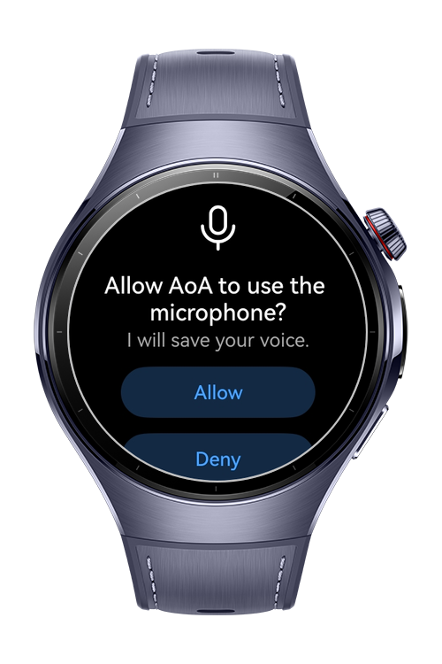
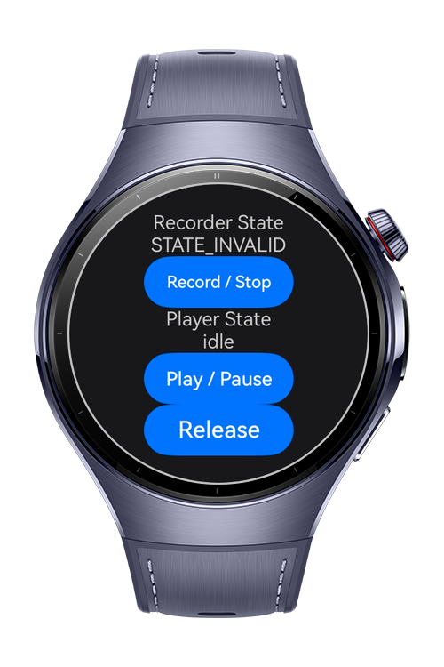

> **Note:** To access all shared projects, get information about environment setup, and view other guides, please visit [Explore-In-HMOS Index](https://github.com/Explore-In-HMOS/hmos-index).

# How to record audio over audio

This app shows how to record audio over audio.

# Preview

<div>
  
  
</div>

# Use Cases

- Record and play audio.
- Second record will continue the first one.

# Technology

## Stack

- **Languages**: ArkTS, ArkUI
- **Frameworks**: HarmonyOS SDK 5.1.0(18)
- **Tools**: DevEco Studio Version 6.0.1.251
- **Libraries**:
    - @kit.AbilityKit
    - @kit.AudioKit
    - @kit.CoreFileKit

## Required Permissions

- `ohos.permission.MICROPHONE`
  > To record audio

# Directory Structure

```
entry/src/main/ets/
├───entryability
│       EntryAbility.ets
├───entrybackupability
│       EntryBackupAbility.ets
├───pages
│       Index.ets
└───service
        Constants.ets
        Player.ets
        Recorder.ets
```

# Constraints and Restrictions

## Supported Device

* Huawei Watch 5

# License

**How to record audio over audio** is distributed under the terms of the MIT License
See the [LICENSE](./LICENSE) for more information.